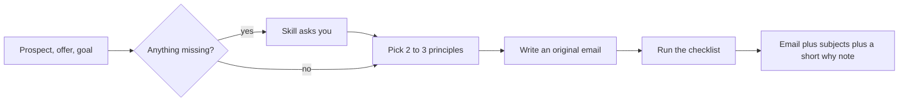
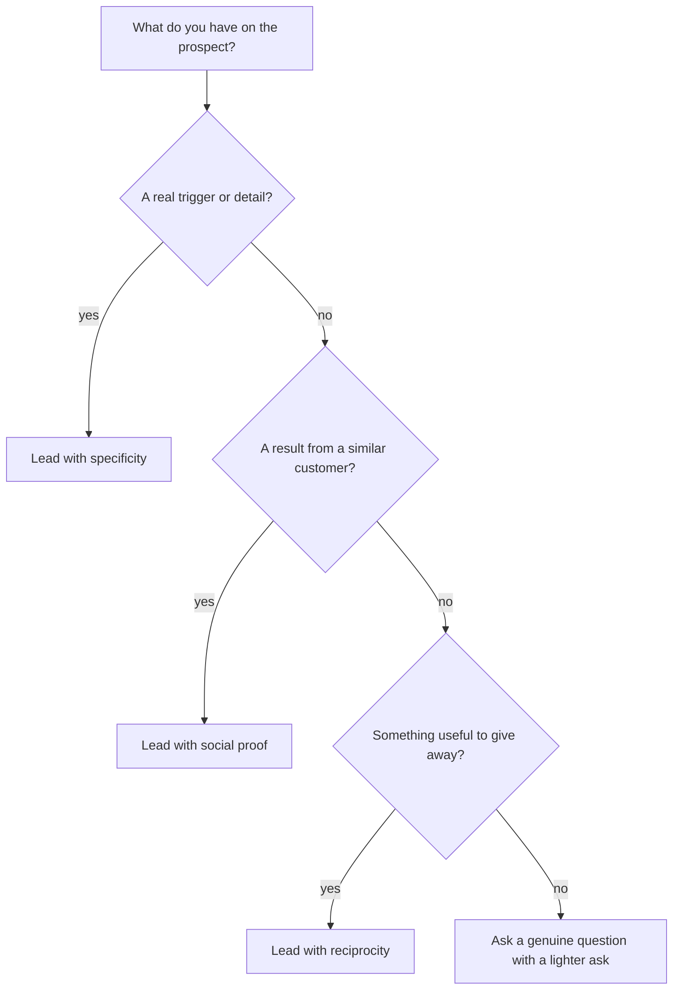

# Claude Cold Email Skill: Sales Psychology for Cold Emails

A free **Claude Code skill** that writes **cold emails**, **follow-up emails** and **subject lines** with **sales psychology**, so your outreach reads as written for one person and your **B2B outbound** earns more replies. It was built by studying 112 public **cold email templates**, guides and real example emails, then turning the patterns behind them into rules Claude applies to your prospect. Use it for cold email examples, follow-up sequences, breakup emails, outreach and a pre-send checklist.

<p align="center">
  <a href="https://github.com/hamzamunyr/claude-cold-email-skill/stargazers"></a>
  
  
  
</p>

<p align="center">
  
  
  
  
  
</p>

<p align="center">
  <a href="#-see-it-in-action">Demo</a> ·
  <a href="#-install">Install</a> ·
  <a href="#-how-to-use">How to use</a> ·
  <a href="#-the-psychology-toolkit">Principles</a> ·
  <a href="#-pick-your-angle">Pick your angle</a> ·
  <a href="#-before-and-after">Before and after</a> ·
  <a href="#-cold-email-faq">FAQ</a> ·
  <a href="#-where-the-patterns-come-from">Sources</a>
</p>

---

## 👀 See it in action

**You type:**

```text
Write a cold email to the operations manager at a 50 person company.
I sell software that cuts manual reporting. Goal: a 15 minute call.
```

**Claude replies:**

```text
Subject options
1. reporting at [Company]
2. your open analyst role
3. quick question on reporting

Hi [First name],

I saw [Company] is hiring a reporting analyst, which usually means
the weekly numbers are still being pulled together by hand.

We automate that report so your team gets it without the manual work.
[Similar company] [real result] in [timeframe] after switching.

Would a 15 minute walkthrough be useful?

[Your name]

Why this works
Specificity (a real job post), a clear cost of the status quo,
social proof (a similar company) and a tiny ask (a short walkthrough).
```

> The skill asks for anything missing first (who the prospect is, your offer, the goal), then writes an original email and runs it through a checklist before showing it. Brackets mark facts only you can supply. It never invents names, stats or results.

---

## ✨ What it does

- 🎯 **Asks for what it needs.** Prospect, offer and goal, before it writes a word.
- 🧠 **Picks 2 to 3 psychology principles** that fit this prospect, from a ranked library.
- ✍️ **Writes an original email.** It never copies a template.
- ✅ **Runs a checklist** and fixes weak lines before you see the email.
- 📨 **Gives you 2 to 3 subject lines** and a short note on which principles it used and why.
- 🚫 **Keeps it honest.** No fake claims, no fake names, no made-up stats.



---

## 🧪 Why psychology beats templates

A template is a shape. A prospect replies to a **reason**.

| Template thinking | Psychology thinking |
| --- | --- |
| "Which template fits?" | "Why would this person care today?" |
| Fill in the name and company | Use one real detail only they would recognize |
| Ask for a meeting | Ask for the smallest next step |
| Add proof when you can | Pick the proof that matches their doubt |
| Hope it feels personal | Check every line against a rule |

Across the sources behind this skill, the same few ideas win again and again: **be short, be specific, ask for little, give something first, and never pretend.**

---

## 📦 Install

<details open>
<summary><b>Option A: as a Claude Code plugin (recommended)</b></summary>

```text
/plugin marketplace add hamzamunyr/claude-cold-email-skill
/plugin install cold-email-psychology@claude-cold-email-skill
```

</details>

<details>
<summary><b>Option B: copy the skill folder by hand</b></summary>

1. Clone or download this repo.
2. Copy `skills/cold-email-psychology` into your skills folder:

```bash
# macOS and Linux
cp -r skills/cold-email-psychology ~/.claude/skills/

# Windows (PowerShell)
Copy-Item -Recurse skills\cold-email-psychology $env:USERPROFILE\.claude\skills\
```

3. Restart Claude Code, or run `/reload-skills`.

</details>

<details>
<summary><b>Check that it works</b></summary>

Ask Claude: *"What skills do you have for cold email?"* You should see `cold-email-psychology` listed.

</details>

---

## 🚀 How to use

Just talk to Claude Code. The skill triggers on requests like these:

```text
Write a cold email to [role] at [type of company]. I sell [offer]. Goal: [meeting / reply / demo].
```

```text
Write a 3 email follow-up sequence for a prospect who went quiet.
```

```text
Improve this cold email: [paste it]
```

```text
Give me 10 subject line options for [offer] aimed at [role].
```

**Tip:** the more real detail you give (a job post, a launch, a post they wrote), the better the email.

---

## 🧠 The psychology toolkit

These are the most common patterns across the emails studied. The full list, with how to apply each one, is in [`principles.md`](skills/cold-email-psychology/references/principles.md).

| # | Principle | In plain English | Where it shows up |
| --- | --- | --- | --- |
| 1 | **Keep it short** | One idea per sentence, readable in 20 seconds | Almost every strong email |
| 2 | **Small first ask** | A 10 minute call or a one line reply, not a 30 minute demo | Hundreds of emails |
| 3 | **Specificity** | One real detail proves it was not blasted | Triggers, posts, job ads, site findings |
| 4 | **Social proof** | A similar company and a real result | Case study and peer emails |
| 5 | **Reciprocity** | Give something useful before you ask | Audits, drafts, short videos, resources |
| 6 | **Consistency** | Refer to your last note so it feels like one conversation | Follow-ups and break-ups |
| 7 | **Curiosity gap** | Hint at the idea without giving it all away | Subject lines and idea offers |
| 8 | **Easy exit** | Make it safe to say no or point you elsewhere | Right-person and break-up emails |
| 9 | **Quantified benefit** | A believable number makes the gain concrete | Result lines |
| 10 | **Lighter ask** | Offer an email answer or one question instead of a call | Busy and senior prospects |

<details>
<summary><b>More principles in the library (click to open)</b></summary>

Empathy, problem agitation, borrowed trust (a mutual contact), competitive comparison, forced choice (two time options), normalization ("many teams like yours"), risk reversal, objection pre-emption, custom calculation, show the work, mutual benefit, exclusivity, humor, and more. Each has a "how to apply" note and a "when not to use it" warning.

</details>

---

## 🧭 Pick your angle

Not sure which principle to lead with? Follow the branch.



---

## 🔁 Before and after

Illustrative drafts that show the difference. Open one.

<details>
<summary><b>Selling a product or service to a business</b></summary>

**Before**

```text
Subject: Revolutionary solution for your business

Hi there, I hope this email finds you well. I'm the CEO of [Company],
the leading platform with powerful features. We help businesses grow.
Do you have 30 minutes for a demo this week?
```

**After**

```text
Subject: [Company] and [specific problem]

Hi [First name],

I saw [one real, specific thing about their company]. That usually
means [the problem it causes].

[Similar company] [real result] in [timeframe] with our help.
Would a 15 minute walkthrough be useful?
```

**Why:** specificity, one proof point, and a smaller ask.

</details>

<details>
<summary><b>Freelancer or agency pitching a new client</b></summary>

**Before**

```text
Subject: Grow your business with us

We are a full service agency with 15 years of experience. We would
love to hop on a call to discuss how we can help you.
```

**After**

```text
Subject: [Company]'s [page or channel], one idea

Hi [First name],

I looked at [Company]'s [website, page or campaign] and noticed
[one specific, real finding]. I wrote up a short list of what I'd
change. Want me to send it over?
```

**Why:** a real finding, free value first, and a yes-or-no ask.

</details>

<details>
<summary><b>Following up when nobody replied</b></summary>

**Before**

```text
Subject: Following up

Just checking in to see if you saw my last email. Let me know.
```

**After**

```text
Subject: re: reporting at [Company]

Hi [First name],

One more thought: [a new fact, result or resource that was not in
the first email]. If now is not the right time, tell me and I will
stop here. Otherwise, would a short call next week help?
```

**Why:** adds something new, gives an easy way out, and asks for little.

</details>

---

## ✅ Tested on 5 scenarios

Before release the finished skill was run on five common requests, and every output was checked against the pre-send checklist (length, one ask, one proof, no hype, no em dashes). Facts in brackets are placeholders you confirm.

<details>
<summary><b>1. First email to a business buyer</b></summary>

**Request:** I sell expense-tracking software. Write to a finance manager at a 50-person company that just opened a second office.

```text
Subject options: second office expenses / [Company]'s new office

Hi [First name],

I saw [Company] opened a second office in [city]. Two locations usually
means expense reports arrive from more people in more formats, and
month-end takes longer.

A 60-person team we work with cut their close from six days to three
after moving receipts into one place [confirm this result before sending].

Worth 10 minutes to see if it fits yours?

[Your name]
```

65 words, one proof, one small ask.

</details>

<details>
<summary><b>2. A freelancer pitching a new client</b></summary>

**Request:** I'm a freelance copywriter. Pitch an online store whose top product page lists specs but not who it is for.

```text
Subject options: one idea for the [product] page / who is [product] for?

Hi [First name],

I read the [product] page on your site. The specs are clear, but the
first screen does not say who it is for or why it beats the cheaper
options, which is usually where visitors decide.

I wrote a short rewrite of the top section. Want me to send it over?

[Your name]
```

56 words, free value first, a yes-or-no ask, no invented proof.

</details>

<details>
<summary><b>3. A 3-email follow-up sequence</b></summary>

**Request:** They did not reply to scenario 1. Write 3 follow-ups.

```text
Day 3 (same thread): a new fact
Hi [First name],
One addition since my note: your careers page lists two new accounting
roles. Teams that add staff and a location at the same time often find
receipt chasing is the first thing to slow down.
Is expense collection already sorted, or still open?

Day 8 (same thread): proof
Hi [First name],
One example that may map: a 40-person firm with two offices had expense
reports arriving in three formats. They moved to a single submission
form and cut approval time from about a week to two days [confirm a
real example before sending].
Not sure it matches [Company]. Should I send the one-page summary?

Day 15 (same thread): a calm close
Hi [First name],
I will stop here so I am not filling your inbox. If expense collection
moves up the list once the new hires settle in, reply and I will pick
it up. If someone else owns this, a name would help. Either way, good
luck with the second office.
```

Each follow-up adds something new, widens the gap and ends without guilt.

</details>

<details>
<summary><b>4. Improving a bad draft</b></summary>

**Request:** Improve this: "AMAZING OPPORTUNITY!!! I hope this email finds you well. I am the founder of GrowthPro, the leading provider of innovative marketing solutions... a 45 minute call... Click here to book. Brochure attached."

```text
Subject options: [Company]'s [recent launch] / question about [launch]

Hi [First name],

I saw [Company] launched [specific thing] last [month]. Launches like
that often bring a spike of visitors who leave before they find [what
it does].

We helped [a real, similar client] [real result]. Worth 10 minutes to
see if the same approach would fit?

[Your name]
```

**What changed:** hype subject and all caps removed, "leading provider" claims replaced by one real proof point, a real detail about them, a 45 minute ask cut to 10, the link and attachment dropped. The skill also flags that the proof and detail must be real.

</details>

<details>
<summary><b>5. Subject lines</b></summary>

**Request:** 6 subject lines for payroll checks aimed at small business owners.

```text
payroll question
overtime at [Company]
one payroll error to check
quick payroll check
who runs payroll at [Company]?
a note on payroll timing
```

All under six words, specific, honest and free of hype or fake "Re:".

</details>

> These are the skill's own outputs on illustrative requests, not measured reply rates. No source in this repo gives verified reply rates, so none are claimed.

---

## 📚 Cold email templates, examples and follow-ups

Everything the skill knows is plain Markdown you can read without installing anything:

- [Cold email examples](skills/cold-email-psychology/references/examples.md): 53 original examples with the psychology behind each
- [Cold email frameworks and structures](skills/cold-email-psychology/references/frameworks.md): 200+ structures with a quick-pick table
- [Cold email follow-up playbook](skills/cold-email-psychology/references/followups.md): how many follow-ups, timing and what each one should add
- [Cold email subject lines and opening lines](skills/cold-email-psychology/references/hooks.md)
- [Call to action types](skills/cold-email-psychology/references/ctas.md)
- [Cold email best practices and deliverability](skills/cold-email-psychology/references/practices.md)
- [Cold email pre-send checklist](skills/cold-email-psychology/references/checklist.md)
- [112 source breakdowns](breakdowns/README.md)

---

## ❓ Cold email FAQ

**How long should a cold email be?** Most sources land between 50 and 150 words. The skill aims for 50 to 120 for a first email and under about 100 for a follow-up, with one idea per sentence and one ask.

**How many follow-ups should I send?** The sources disagree (from 2 to 9). The skill defaults to the first email plus 3 follow-ups, and every follow-up has to add something new. See the [follow-up playbook](skills/cold-email-psychology/references/followups.md).

**When should I send the first follow-up?** About 2 to 3 business days after the first email, then widen the gaps.

**What makes a good cold email subject line?** Short (2 to 5 words), specific and honest. No hype words, no fake "Re:" and no clickbait.

**Is cold email spam?** It depends on consent rules where the recipient is, on whether it is relevant and honest, and on how you send it. The skill's [practices guide](skills/cold-email-psychology/references/practices.md) summarizes the basics (CAN-SPAM, GDPR, opt-outs, authentication). It is not legal advice.

**Does the skill guarantee replies?** No. It gives you a stronger draft built on patterns from real emails. Results depend on your list, offer and timing, and no reply rates are claimed here.

**How do I install it?** Run `/plugin marketplace add hamzamunyr/claude-cold-email-skill` in Claude Code, then install the plugin. See [Install](#-install).

---

## 🌍 Where the patterns come from

The skill is built on **112 public sources**: template libraries, vendor guides and real example emails. A few of the biggest:

| Source | What it added | Breakdown |
| --- | --- | --- |
| **Hunter** | A 510 template library. Showed how a curated set beats a crowd-sourced one, and the power of the "lighter ask" | [Read](breakdowns/015-hunter.md) |
| **Woodpecker** | 75 templates across sales, recruiting, real estate and follow-ups | [Read](breakdowns/004-woodpecker.md) |
| **HubSpot** | 22 B2B templates. Multiple-choice break-ups, custom ROI math, objection pre-emption | [Read](breakdowns/013-hubspot.md) |
| **SmartWriter** | Annotated good and bad emails side by side | [Read](breakdowns/009-smartwriter.md) |
| **Smartlead** | 19 emails and four variables that make personalization real | [Read](breakdowns/008-smartlead.md) |
| **Proposify** | Real example emails, including a custom video of the prospect's own site | [Read](breakdowns/014-proposify.md) |

Every source has its own write-up in [`breakdowns/`](breakdowns/), with what worked, what did not, and an honest note when no results were published. Where a source gave no reply rates, this repo says **"not provided"** and never fills the gap.

### What is inside

| Folder | What you get |
| --- | --- |
| [`skills/cold-email-psychology/`](skills/cold-email-psychology/) | The skill itself |
| [`references/principles.md`](skills/cold-email-psychology/references/principles.md) | 40+ principles with counts and how to apply each |
| [`references/frameworks.md`](skills/cold-email-psychology/references/frameworks.md) | 100+ email structures |
| [`references/hooks.md`](skills/cold-email-psychology/references/hooks.md) | Opening lines and subject line patterns |
| [`references/ctas.md`](skills/cold-email-psychology/references/ctas.md) | Types of asks and when each works |
| [`references/examples.md`](skills/cold-email-psychology/references/examples.md) | 53 original example emails |
| [`references/checklist.md`](skills/cold-email-psychology/references/checklist.md) | A pre-send checklist the skill runs on every draft |
| [`references/practices.md`](skills/cold-email-psychology/references/practices.md) | Writing, follow-up, list and deliverability practices from 8 guides |
| [`references/followups.md`](skills/cold-email-psychology/references/followups.md) | How many follow-ups, timing, what each touch does, phrases to avoid |
| [`breakdowns/`](breakdowns/) | One analysis per source |

---

## 🤝 Contributing

Found a great cold email source, a pattern that is missing, or a line the checklist should catch? Open an issue or a pull request.

- [ ] Share a source with its link and a note on what is useful
- [ ] Suggest a principle, hook or checklist item
- [ ] Report an email the skill wrote that felt generic or pushy

**Rules for contributions:** analysis and paraphrase only, never paste a source's email body into a public file, and never invent results.

---

## ⚖️ Use it responsibly

Cold email is regulated. Follow the rules where you send (for example CAN-SPAM and GDPR), include a clear sender identity and an opt-out, and only write to people you have a real reason to contact.

---

## 📄 License

[MIT](LICENSE). Use it, change it, share it.

---

## ⭐ If this helped

If this skill saved you time or got you a reply, please consider giving the repo a star. It helps other people find it.

## 👤 Author

**Built by Hamza Munir, software engineer and GTM engineer.** More at [thepixelserve.com](https://thepixelserve.com).

[](https://thepixelserve.com) [](https://www.linkedin.com/in/hamzamunyr/)
